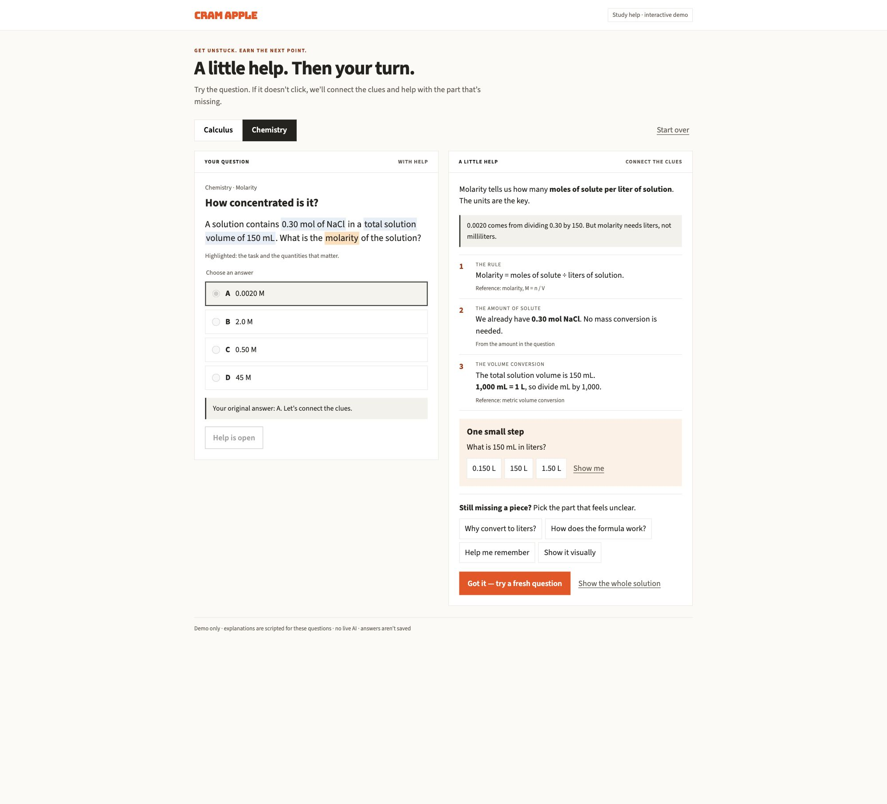

# Preserved More help mock and source

This bundle preserves existing artifacts. It is not a new demo build or publication.

- **[scripted-mock.html](scripted-mock.html):** complete original scripted two-subject mock from source `bea990edf4fb502e6bef3c6abc3f1d4607dc028a`. Open directly in a browser; add `?subject=calc` or `?subject=chem` when served. Its earlier labels/microstep are historical; use the [later decisions](../../product/MORE_HELP_DECISIONS_AND_DESIGN.md) when revising.
- **[scripted-help-preview.jpg](scripted-help-preview.jpg):** original screenshot of Chemistry help, highlighting, three relevant facts, focused follow-ups and a fresh-question action. This is scripted, not live AI output.
- **[question-entry-preview.jpg](question-entry-preview.jpg):** saved live candidate's Chemistry question/answer/checking UI. It does not demonstrate successful generation.
- **[lessons.ts](lessons.ts):** exact two fixed questions, verified calculations, source IDs, recall aids and focus buttons.
- **[live-demo-source.tar.gz](live-demo-source.tar.gz):** complete tracked editable source at `39d91166227c314e235e5ca2ff31de1891e0a259`, exported with `git archive`; contains no node_modules, build output, local database or credentials. This is distinct from the Sites compiled deployment archive.
- **[manifest.json](manifest.json):** hashes and provenance for all artifacts.

Restore the saved editable source only when a dynamic-demo restart is authorized:

```sh
mkdir more-help-restored
tar -xzf docs/design-reference/more-help/live-demo-source.tar.gz -C more-help-restored
```

The archived README predates the owner’s pause; the current restart handoff supersedes its earlier invitation/top-up next actions. The restored package scripts and `.openai/hosting.json` describe the existing Sites runtime and project. Dependency installation and model calls are not needed to reopen the HTML mock. Do not create another Sites project or deploy merely to look at a screenshot.



See the [restart handoff](../../handoffs/MORE_HELP_SESSION_HANDOFF_2026_10_13.md) for pause authority, the last live-generation failure, exact saved version and future work boundaries.
