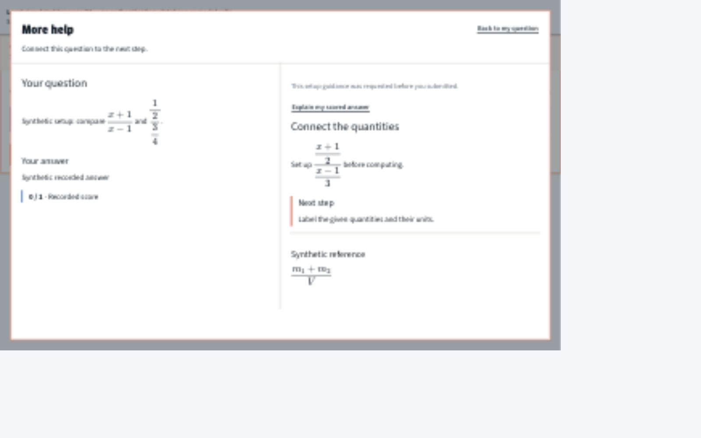
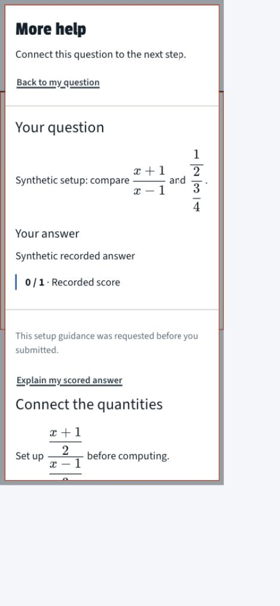

# More help — follow-up action and local browser evidence

Date: 2026-10-14 (America/New_York). Producer review by Codex; **release remains NOT READY**. This is not a new independent Claude verdict.

The supplied `/Users/davidbloom/Documents/Cramapple/docs/qa/QA_MORE_HELP_RELEASE_FOLLOWUP_2026_10_14.md` path is absent locally. The canonical GitHub/local isolated-checkout report is unchanged: SHA-256 `3b54e9519cc9814954f4cc1b0287c9e15cfeb113d4b475717a151d22426e3505`, original commit `e365d52b`. Both original independent reports are preserved.

## Current disposition

- **N1:** fixed by targeted case/letter handling and removal of the overly broad numeric conclusion branch. No new blanket answer-string matching.
- **N2:** supplied ordinary explicit choice verdicts are rejected. Numeric paraphrases and broader conceptual disclosures remain human-dependent under the owner's targeted-plus-human decision. No universal leak-prevention claim.
- **N3:** phase-control reset is in draft app [PR #25](https://github.com/david-bloom/ap-prep-blueprint/pull/25). Added real-browser local evidence below; authenticated serving/grading coverage remains open.
- **N4:** the supplied rate conclusions are covered, including the subsequently restored zero-denominator/zero-change predicate. Chemistry/MVT semantic cases still require red-team reading.
- Backend [PR #442](https://github.com/david-bloom/Cramapple/pull/442) merged at `953640f3aff03eb54c26c766e5c2fdea02c66669`. Backend code checkpoint remains `8c437bd4d96456e3693fcee067412e532774d1da`; prior Development v10 source/bundle verification is recorded in the remediation. No new deployment or database verification in this pass.
- App code checkpoint is now **`e1d49d9ed4ed1be1e14897c6db967f9d49b5042b`**, adding the nested-fraction fix below to the previous `c5c26997` phase-reset checkpoint. App #25 remains draft; no merge or publication by this pass.

## Confirmed additional defect and fix: F6 nested fractions

The visual rule measures the computed font size of the elements painting readable glyphs, excludes KaTeX spacers and exempts ordinary superscripts/subscripts/limits. Fraction numerator/denominator digits are not exempt (`docs/new_design/VISUAL_IDENTITY.md`, typography section).

In the actual More help components, `$\frac{1}{\frac{2}{\frac{3}{4}}}$` rendered the innermost 3 and 4 at **11.7px**, although simple fractions were 23.4px and one level of nesting was 16.38px. A top-level `\displaystyle` still lets KaTeX shrink inner fractions.

The app fix adds an opt-in Formula/MathText setting for display-sized fractions, used throughout More help's existing math-rendered fields. KaTeX expands `\frac` and `\tfrac` as `\dfrac` for this surface; it owns the layout and fraction metrics. Stored source, recovered annotation source, ordinary subscript behavior and the default renderer on other surfaces are retained. No global font-size override or post-render DOM mutation.

After the fix, every measured non-script glyph in the synthetic question, nested guide and reference formula is **23.4px**. The reference's ordinary `m_1` / `m_2` subscripts remain **16.38px**. This covers the tested ordinary fraction expressions, not every possible authored macro/style combination. Two regressions cover deep fractions, script preservation and both highlighted/unhighlighted question paths.

## Executed local browser checks

The real TaskPane, MoreHelp, request library, CSS and KaTeX/fonts were loaded in an isolated localhost fixture. Help transport/receipt reads, issue reporting and photo preparation were mocked. Scoring controls inject an existing typed grading shape; there is no real submission, database, authentication, provider invocation or student data. Fixture files remain outside both repositories at `/private/tmp/cramapple-more-help-browser`; no private app source or authored bank content is copied into this public report.

| Check | Observed result | Limit |
| --- | --- | --- |
| Typed work → open/close loading help | Work remains in the answer field; focus returns to More help | Local fixture |
| Pending help → scoring transition → mocked delivery | One request resolves; explanation remains available and is labelled as pre-submission setup guidance; explicit scored-answer action is visible even with no generated follow-ups | Transport/scoring mocked; does not prove durable live allowance |
| Scored FRQ controls | Comparison starts closed; old typed draft is absent | Actual mounted TaskPane, injected grading |
| Revision → help → close | Revision starts empty, displays the new work in help and preserves it on close; recorded score stays 0/1 | Locked-score authority still needs live/database integration evidence |
| Disabled photo preparation → review → practice | Photo-control availability resets | Photo callback mocked; no photo pipeline claim |
| MCQ A selected → review → same-question practice | Neither radio remains selected; submit is disabled | Synthetic choices; no real MCQ serving/grading claim |
| Focus and Escape | Shift+Tab from first control cycles to last; Tab from last cycles to first; Escape closes and returns focus to More help | Local dialog |
| 1280 CSS px desktop | Two panes; no page horizontal overflow; measured glyphs 23.4px | Synthetic content |
| 375 CSS px phone | Stacked panes; page width 375px; dialog client/scroll widths both 357px; measured glyphs 23.4px | Synthetic content; not authenticated mobile |
| Action targets | Back and scored-answer controls measure 43.984375px height, matching the 44px CSS rule within layout rounding | Local dialog |

Viewport dimensions above are measured DOM CSS widths. The browser's existing scale made its viewport override values differ; settings were not changed and the temporary override was reset. The owned server and temporary tab were closed. During editing, the fixture's hot reload emitted a duplicate createRoot warning and reset fixture state; checks resumed from the observed reset state. This harness warning is not attributed to the production app. No claim that a signed-in browser passed follows from these results.

Validation on the new app checkpoint: **119 test files / 1,144 tests pass; TypeScript and build pass**. Focused More help/formula set: 40 tests pass. Existing route/deprecation warnings remain; no new build failure. Backend code was not changed or retested in this UI-only pass; its prior 26-test/typecheck evidence remains separate.

Desktop evidence (local simulation):

Phone evidence (local simulation):

Image SHA-256: desktop `ebcf50ff6c4399c0739222f66f5fd6b0d9aea664e398596acf25e84894e7b238`; phone `12dd3f401f9cb0b86cefdaaae625f4a21e666cc899c1832b7f3e3230dc5000f0`.

## Remaining release gates

1. Independent review of the updated app/backend checkpoints and human reading of real outputs, particularly numeric/MCQ and Chemistry/MVT conceptual disclosures. Original FAIL reports are historical, not a new PASS.
2. The pinned Development MCQ mirror and bounded 12-call Gateway plan remain unexecuted; their separate write/call questions remain unanswered. Prior grading-experiment authorization is not a More help allowance.
3. Authenticated real-question matrix, submission/revision/refresh/two-tab behavior, glyph measurements on served content, and actual grading/photo availability. A separate successful synthetic Gateway grading experiment does not verify deployed evaluate-attempt.
4. Required source review/merge, four Production migrations, exact function/JWT/origin/Gateway verification, app publication and signed-in Production smoke with the documented rollback plan.

No model/grading/photo call, database write, new secret, credit purchase, Production mutation or release in this pass. Follow-up independent prompt is updated to this checkpoint and asks the reviewer to challenge these local evidence limits.
